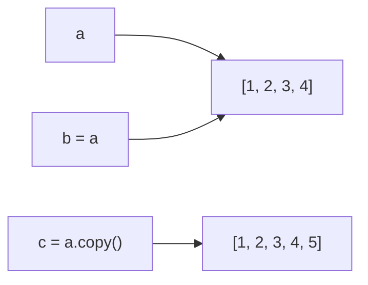

# 变量与拷贝（D1 笔记）

> 配套实验：`mem_demo.py` 实验一。这份笔记只回答一个问题：
> 为什么 `b = a` 之后改 `b` 会连累 `a`，而 `copy()` 不会。

## 一、一句话

`b = a` **没有创造第二个对象**，只是让 `b` 这个名字也指向 `a` 指向的那个对象；
`copy()` 才会真正在堆上再分配一块内存。所谓"连累"，不是赋值造成的，而是两个名字共用同一份数据。

## 二、四行输出就是证据

```
a、b 是同一个对象吗？ True            ← id 相同，同一个对象
改 b 之后，a 变成什么？ [1, 2, 3, 4]   ← 改的是共享的那个对象
c、a 是同一个对象吗？ False           ← copy 新建了对象
改 c 之后，a 是什么？ [1, 2, 3, 4]     ← 改的是另一块内存
```

`id()` 判的是**身份**，`==` 判的是**值相等**。两件事，别混用。

## 三、机制拆解



1. **`a = [1, 2, 3]`**：列表对象创建在堆上，`a` 只是栈帧里一个指向它的名字。名字在栈上，身体在堆上。
2. **`b = a`**：赋值只动名字，不动对象。`b` 绑到同一地址，`id(a) == id(b)` 为 True。
3. **`b.append(4)`**：`append` 是**原地修改**，没有创造新对象，只是往那块内存里塞了个 4。因为 `a`、`b` 是同一个对象，`a` 自然"变成"了 `[1, 2, 3, 4]`。
4. **`c = a.copy()`**：堆上新分配一个列表，把 `a` 的**元素引用**逐个拷进去，`c` 绑到新对象上。此后 `c.append(5)` 只动新的那块。

## 四、判据：`mutate` 还是 `rebind`

"`b = a` 是引用传递所以改 `b` 影响 `a`"——这句话是**不准的**，下面两种写法都不会连累 `a`：

```python
b = a
b = b + [4]    # 新建了一个列表，b 改指向新对象，a 纹丝不动
b = []         # 同上，只是重新绑定
```

真正决定是否连累的，只有一条：**这一步是动对象，还是动名字。**

| 写法 | 类型 | 影响 `a` 吗 |
|---|---|---|
| `b.append(4)`、`b.sort()`、`b[0] = 9` | mutate（动对象） | 会 |
| `b = ...`、`b = b + [...]` | rebind（动名字） | 不会 |

所以更准确的说法是：**通过 `b` 改它指向的那个对象，`a` 也看得见，因为它们本来就是同一个对象。**
Python 里也没有"传引用"这个正式说法，准确讲是**传对象引用（call by object reference）**。

## 五、`copy()` 的边界：只复制一层

`copy()` 是**浅拷贝**，只复制最外层容器，元素仍是原来的引用。元素本身若是可变对象，照样共享：

```python
a = [[1, 2], 3]
c = a.copy()
c[0].append(9)     # 内层列表还是同一个对象
print(a)           # [[1, 2, 9], 3]   ← 依然被连累
c[0] is a[0]       # True
```

要彻底隔离得用 `copy.deepcopy(a)`，它递归复制每一层。
**"`copy()` 不会连累"这个结论只在「元素都是不可变对象」时成立**，答不出这个边界，就还是没懂。

## 六、不可变对象为什么看起来"安全"

```python
x = 1
y = x
y += 1        # int 不可变，这一步是新建对象再重新绑定
print(x)      # 1
```

`int`、`str`、`tuple` 上根本没有"原地修改"这回事，所以永远不会连累。
这也说明：**与其记"引用 / 值"，不如记"可变 / 不可变"**——前者是说法，后者才决定行为。

## 七、和实验二、三怎么串起来

- 实验一：名字在栈上，对象在堆上 → 两个名字可以指向同一个堆对象。
- 实验二：函数返回时栈帧销毁，但堆对象只要还有引用就活着，所以内外 `id` 相同。
- 实验三：栈有固定大小，递归每调一次压一帧，压满就 `RecursionError`。这是栈的问题，与堆无关。

一条线：**栈管"谁在引用"，堆管"引用的东西"；回收看堆对象的引用计数。**

## 八、自测（先写预期再运行）

```python
a = [1, 2, 3]
b = a
b += [4]          # ① a 是什么？
b = b + [5]       # ② a 是什么？
c = a[:]          # ③ c 是 a 的副本吗？
```

答案：① `[1,2,3,4]`（`+=` 对列表是原地扩展，仍是 mutate）；② 仍是 `[1,2,3,4]`（`+` 新建对象）；③ 是浅拷贝副本，`c is a` 为 False。

**① 是最容易错的一题**：`+=` 看着像重新绑定，对可变对象却是原地操作。
